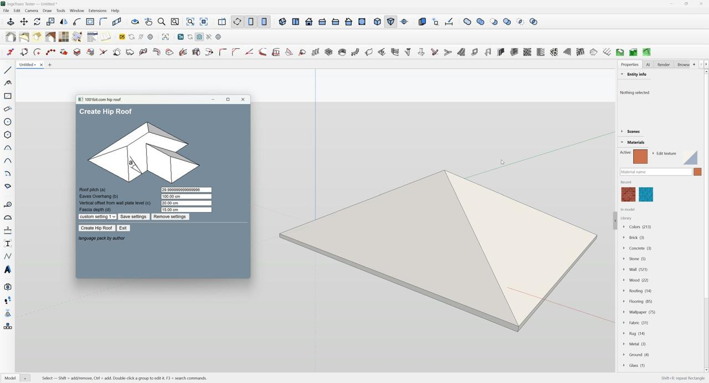

# SketchUp Plugin Adapter for IngeTrazo

> **Experimental — needs tuning. Pull requests are welcome.**

A hobby project exploring how classic SketchUp Ruby plugins can work inside
IngeTrazo. This repository contains the complete adapter runtime, installer,
example plugin, and public regression tests. A separate Ruby worker executes
supported extension code and exchanges commands, dialogs, tool events and
geometry with IngeTrazo.



*Reference capture from an adapter test. It is not a guarantee that every plugin,
command or generated shape is correct.*

## Download and install

1. [Download the full repository ZIP](https://github.com/hamzah1985/sketchup-adapter/archive/refs/heads/main.zip)
   using **Code → Download ZIP**, or clone this repository. Extract it to a
   permanent folder.
2. Have a compatible IngeTrazo installation and standalone Ruby available.
   The validated environment was Windows, the IngeTrazo tester's Python 3.12 / Qt
   extension API, and Ruby 3.2. Other host versions and operating systems are
   unverified. Qt and QtWebEngine are supplied by the compatible IngeTrazo host.
3. From the extracted folder, install the adapter loader:

   ```powershell
   python install.py --no-example
   ```

   On Windows it is installed under `%APPDATA%/IngeTrazo/plugins/sketchup_adapter/`.
   The installer records exact backups and SHA-256 hashes of previous adapter
   files. It attempts rollback if installation fails.
4. If Ruby is not on PATH, set its executable before starting the worker:

   ```powershell
   python -m sketchup_adapter.cli settings --ruby "C:\Ruby32-x64\bin\ruby.exe"
   ```

5. Save your model, restart IngeTrazo, and open
   **Extensions → SketchUp Plugin Adapter…**. Register an RBZ or a folder with
   root `.rb` loaders. New third-party entries start disabled. Set dependencies,
   enable the required entries, and restart IngeTrazo to apply the enabled set.

Keep the extracted source folder in place: the installed loader links to it.
This is an IngeTrazo extension; this source archive is not an RBZ to install in
SketchUp. Plugin packages, vendor licenses and plugin dependencies are obtained
separately. Imported extensions execute with your user account's permissions;
the Ruby worker is not a security sandbox.

An authored sample plugin is in `examples/`. Run `python install.py` without
`--no-example` to register and enable it during installation.

## What is included

| Path | Purpose |
| --- | --- |
| `sketchup_adapter/` | Complete Python host integration and Ruby compatibility runtime |
| `sketchup_adapter/ruby_host/su/` | Implemented SketchUp, geometry, model, entities and UI interfaces |
| `install.py` | Source-linked IngeTrazo installer with backup and rollback |
| `examples/` | Authored example Ruby plugin |
| `tests/` | Public Python tests, Ruby smoke tests and behavior contracts |
| `COMPATIBILITY.json` | Recorded checkpoint results, runtime hashes and known failures |
| `public_files.json` | Explicit inventory of all public runtime source files |
| `build_release.py` | Source archive builder with inventory and hash checks |
| `SOURCE_MANIFEST.json` | SHA-256 hashes of the source release members |

The landing page is built from `index.html`, `styles.css` and `assets/`.

## Current limits

The adapter implements a subset of SketchUp's Ruby API. Loading a plugin or
opening its dialog does not certify its tools or geometry.

- Face ownership, nested edits, topology and some interactive workflows remain
  incomplete. Recorded 1001bit Opening, Bevel, and planar Cut and Fill fixtures
  have known failures. Some commands can time out.
- Unitless length parsing still defaults to millimeters; document changes,
  timers and queued work have unresolved lifecycle cases.
- Instant Roof has produced open boundary edges in measured fixtures.
- RBE execution is unsupported. Legacy RBS support requires separate local
  format configuration, which is not supplied. Vendor authorization behavior
  is preserved.
- Cancellation is cooperative. Once native geometry preparation has begun,
  an operation may finish; use Undo to remove its result.
- The optional walkthrough avatar assets are omitted because redistribution
  requires separate consent; its adapter code and notice are included.

The checkpoint in `COMPATIBILITY.json` is dated 4 November 2026. Its results
describe bounded cases, not a compatibility percentage. The complete local
native test environment and licensed plugin fixtures are not part of this
repository. Evaluate experimental tools in disposable models.

## Tests and contributions

Run the public Python checks and independent RBS container check from the
repository root:

```powershell
python -m unittest discover -s tests -p "test_*.py"
ruby tests/rbs_container_smoke.rb
```

Additional Ruby behavior contracts are in `tests/`; see [CONTRIBUTING.md](CONTRIBUTING.md).
Fresh publication checks and their remaining instability are recorded in
[VALIDATION.md](VALIDATION.md).
The pinned recipes in `tests/open_source_repositories.json` and
`tests/download_open_source_suite.py` let developers download original
open-source fixtures separately into Downloads. These external plugins are not
bundled with the adapter.

Rebuild the source archive with:

```powershell
python build_release.py
```

Report the plugin/version, adapter revision, exact steps and expected versus
actual geometry in an issue. Focused pull requests and reproducible tests are
welcome. Keep proprietary plugin packages, activation data and private models
out of contributions.

## License

Adapter source is GPL-3.0-or-later. See [LICENSE](LICENSE) and component notices.
SketchUp and third-party plugins remain the property of their respective authors.
This is an independent compatibility experiment.
